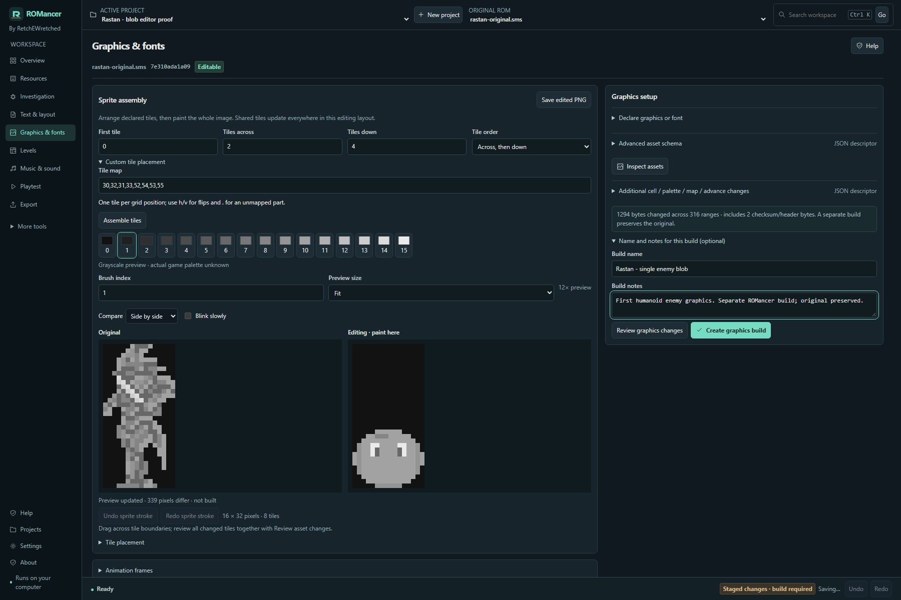

# ROMancer v1.0.0

**[Download the portable ZIP for Windows x64](https://github.com/RetchERez/ROMancer/releases/download/v1.0.0/ROMancer-v1.0.0-Windows.zip)**

By **RetchEWretched**. Edit ROMs, preview changes, playtest builds, and export patches offline.

## Get started on Windows

1. In File Explorer, right-click **ROMancer-v1.0.0-Windows.zip** and choose **Extract All**.
2. Pick a destination and click **Extract**. Open the extracted folder.
3. Double-click **ROMancer.exe**. Keep it next to the **ROMancer Files** folder.

The ZIP includes the runtime, emulator engines, and offline user guide. Try an included practice ROM or choose **New project** to import your own. Open **Help → User guide** for a walkthrough. The launcher is unsigned, so Windows may show a SmartScreen warning.

[User guide (PDF)](https://github.com/RetchERez/ROMancer/releases/download/v1.0.0/ROMancer-v1.0.0-User-Guide.pdf) · [Tested games](https://github.com/RetchERez/ROMancer/releases/download/v1.0.0/TESTED-GAMES.txt) · [Release and checksums](https://github.com/RetchERez/ROMancer/releases/tag/v1.0.0)

## Editors in action

### Graphics & fonts

Assemble tiles and paint the full sprite. Here, Rastan’s first humanoid enemy is being redrawn as a single blob alongside the original.

### Text & layout

Edit dialogue, see how many bytes it needs, and preview a move to reserved space for longer text.

### Hex editor

Select a byte and see its ASCII character. Staged edits are underlined and can be reviewed before creating a separate build.

## Supported systems

NES, SNES, Genesis / Mega Drive, Master System, Game Boy, and Game Boy Color. Structured editors use checked definitions for the selected ROM revision. See the tested games list for the exact edits and playtest routes verified. Visual level editing is coming soon.

[Build and technical documentation](../README.txt) · [MIT license](../LICENSE)
