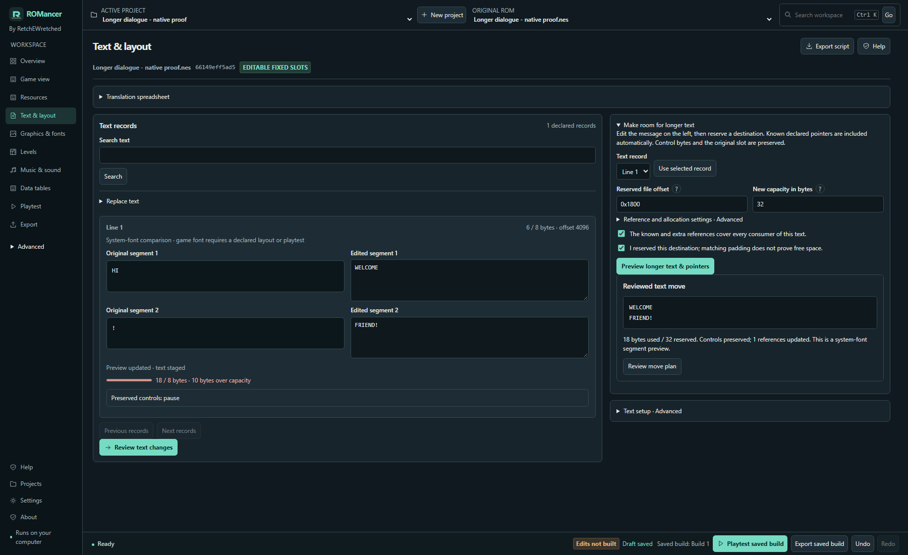
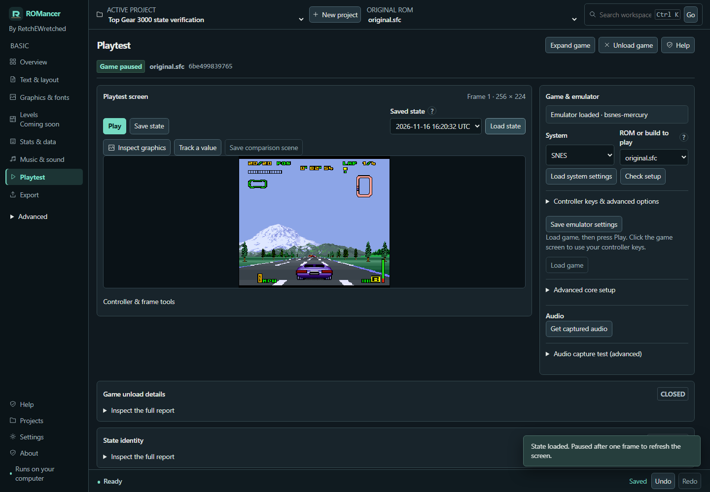

# ROMancer v1.3.8

**[Download for Windows x64](https://github.com/RetchERez/ROMancer/releases/download/v1.3.8/ROMancer-v1.3.8-Windows.zip)** · **[Download for Linux x86-64](https://github.com/RetchERez/ROMancer/releases/download/v1.3.8/ROMancer-v1.3.8-Linux-x86_64.tar.gz)**

By **RetchEWretched**. Edit ROMs, preview changes, playtest builds, and export patches offline.

## New in v1.2

- **Scenes & colors reaches more games.** The color search now finds stored palettes and colors a cartridge chip prepares, background cells built from blocks can be changed through the stored block, and more packed graphics formats are re-packed after an edit.
- **Fixes.** Window title, message spacing, a proofread user guide, and the Extras ZIP is back.

## New in v1.1

- **Scenes & colors editor.** Record moments of the game, change a color, and the **Also changes** strip replays every recorded scene that uses the same data in the real engine, so you see what else changes before you save. Works on all six systems without a game-specific definition.
- **Tile and background editing.** In the same editor, redraw a picture pixel by pixel or paint pictures into background cells. Packed graphics are re-packed when ROMancer recognises the packing; otherwise the build gets a small run-time patch, shown both in the scene and from power-on.
- **Accurate catalog.** The catalog now lists 942 cartridge dumps that match the No-Intro reference lists exactly, under their No-Intro names. Fan translations, re-release dumps and entries that did not boot were removed.

New in v1.3.8: going back to a scene you already opened no longer waits (up to 7.9 seconds before, under a tenth of a second now, on 7 measured games) and Save all graphics (ZIP) is 2 to 9 times faster; the first opening of a scene and the replay check take as long as before.

New in v1.3.7: whole characters and objects save as one PNG, each put together from its sprites the way the game shows it, and load back; on an 80-game sample 73 had sprites on screen, all 73 read back unchanged, and a drawn-on object was confirmed by replay on 61.

New in v1.3.6: Super NES Mode 7 layers (a racing track, a world map) save as a flat 1024 by 1024 PNG and read back unchanged on all 9 catalog games that have one; drawing on them is confirmed on 3.

New in v1.3.5: a background PNG can rearrange the background. Copy the square of one cell over another and ROMancer gives that cell that picture, checked by replay (confirmed on 71 of 80 games measured).

New in v1.3.4: a PNG whose pictures are stored in different ways is no longer cut in half by a clash over the header checksum (39 of the 51 games this stopped now confirm every picture).

New in v1.3.3: picture edits are confirmed on more NES games that switch picture banks or only show an edit from an earlier save point (13 of the 32 games that confirmed none before).

New in v1.3.2: closing the window now stops the local service, and **Save all graphics (ZIP)** saves the pictures and background layers of every recorded scene as PNG in one file.

New in v1.3.0: any recorded scene can save its pictures and background layers as PNG and load an edited PNG back as one replay-checked change (saving works on 939 of 942 ROMs; an edited PNG had at least one picture confirmed on 887).

Measured across all 942 catalog entries: a color edit was confirmed by replay on 939 ROMs, a picture edit on 936 and a background edit on 922. Per-ROM results are in [trace/COVERAGE.md](../trace/COVERAGE.md); limits are in the [release notes](https://github.com/RetchERez/ROMancer/releases/tag/v1.3.8).

## Get started on Windows

1. In File Explorer, right-click **ROMancer-v1.3.8-Windows.zip** and choose **Extract All**.
2. Pick a destination and click **Extract**. Open the extracted folder.
3. Double-click **ROMancer.exe**. Keep it next to the **ROMancer Files** folder.

The ZIP includes the runtime, emulator engines, tracing engines for Scenes & colors, and offline user guide. Try an included practice ROM or choose **New project** to import your own. Open **Help → User guide** for a walkthrough. The launcher is unsigned, so Windows may show a SmartScreen warning.

[User guide (PDF)](https://github.com/RetchERez/ROMancer/releases/download/v1.3.8/ROMancer-v1.3.8-User-Guide.pdf) · [All 942 ROM revisions](../knowledge/ROM-CATALOG.md) · [Tested games](https://github.com/RetchERez/ROMancer/releases/download/v1.3.8/TESTED-GAMES.txt) · [Release and checksums](https://github.com/RetchERez/ROMancer/releases/tag/v1.3.8)

## Get started on Linux

```
tar xf ROMancer-v1.3.8-Linux-x86_64.tar.gz
./ROMancer-v1.3.8-Linux-x86_64/ROMancer.sh
```

Python, the emulator engines and the tracing engines are included; nothing is installed system-wide. Needs glibc 2.28 or newer (Ubuntu 20.04+, Debian 10+, Fedora 29+, SteamOS 3) and a web browser. Run `./ROMancer.sh --install-desktop` to add a menu entry. Native debugger captures are Windows-only.

## Editors in action

### Mega Drive palette editor

Change palette colors and replay the same scene to see their effect. In **Sonic the Hedgehog**, six palette edits turn Green Hill Zone’s grass and palms purple and pink. The saved build reproduced the editor’s gameplay preview pixel for pixel.


### Graphics & fonts

Assemble tiles and paint the full sprite. Here, Rastan’s first humanoid enemy is being redrawn as a single blob alongside the original.


### Text & layout

Edit dialogue, see how many bytes it needs, and preview a move to reserved space for longer text.



### Hex editor

Select a byte and see its ASCII character. Staged edits are underlined and can be reviewed before creating a separate build.


### Playtest and save states

Play your ROM or a saved build, capture scenes, and resume from a save state. Here, **Top Gear 3000** has been restored mid-race in the built-in SNES playtest.



## Supported systems

NES, SNES, Genesis / Mega Drive, Master System, Game Boy, and Game Boy Color. The [full ROM catalog](../knowledge/ROM-CATALOG.md) lists every recognized revision with CRC32 and SHA-256. Open **ROM Catalog.html** from the extracted ZIP to search and filter offline. All 942 cataloged revisions passed the byte-edit, undo/redo, build, and BPS workflow. Structured editors use checked definitions for the selected revision. The tested games list shows the game-specific edits and playtest routes verified. Visual level editing is coming soon.

[Build and technical documentation](../README.txt) · [MIT license](../LICENSE)
